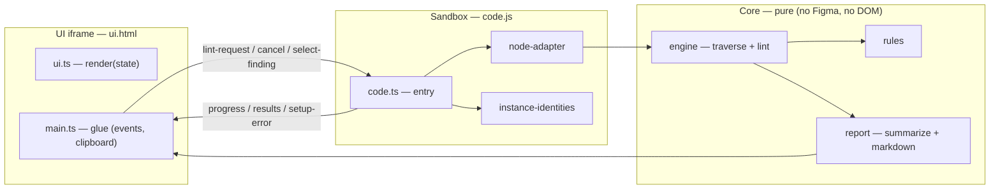

# Infomaniak's Design System - Figma Design Linter

A Figma plugin that lints a selection for design-token compliance. A designer selects
one or more layers, runs the plugin, and gets a list of errors and warnings. This
first slice ships the read-only foundation — scan scopes, rule-grouped results,
report export — with the `lorem-ipsum` check (leftover placeholder copy); the
design-token rules and the fix mode land in follow-up slices.

The plugin reads the document and lints it; it never modifies it.

## What it checks

| Rule        | Severity | Meaning                                                                     |
| ----------- | -------- | --------------------------------------------------------------------------- |
| Lorem ipsum | Warning  | The text layer still carries placeholder copy (`lorem`/`ipsum`, any casing) |

The pattern set is word-bounded and case-insensitive: `lorem` or `ipsum` as
standalone words. Real product copy never contains these words, and partial matches
("Lorem-ipsum-body", "LOREM IPSUM DOLOR") are caught too.

## Using the plugin in Figma

### Build and install (development)

```shell
yarn build:figma-plugin-linter
```

Then, in the Figma desktop app:

1. Go to **Plugins → Development → Import plugin from manifest…**
2. Select `packages/figma/figma-plugin-linter/manifest.json`

> [!NOTE]
> The manifest `id` is a placeholder (`TODO_ID`) until the first desktop import assigns
> the real plugin id. Distribution to the org is done as a private plugin (see the
> spec's rollout plan).

### Run a lint

1. Pick a scope in the panel — **Selection** (default), **Page** or **File**
2. For the Selection scope, select one or more frames or layers on the canvas
3. Open the plugin and hit **Run lint**
4. Results appear as `N errors · M warnings`, errors first, **grouped by rule within
   each severity** — expand a rule section to see its findings and their messages
5. Click a finding to select the offending layer on canvas (and zoom to it)
6. Hit **Copy report** to get a markdown summary for handoff tickets (same rule
   grouping)
7. Fix the layers and hit **Run again** — results are a snapshot, there is no live watching

The Selection scope requires a non-empty selection (setup error otherwise). The Page
scope lints the current page's top-level layers and their subtrees; the File scope
lints every page. An empty page or file is a clean pass. Progress and cancel work the
same in every scope.

| State       | Reached when                   | Content                                                                            |
| ----------- | ------------------------------ | ---------------------------------------------------------------------------------- |
| Idle        | Plugin opened, nothing run yet | Title, scope picker, Run button, hint                                              |
| Setup error | No selection (Selection scope) | Blocking message with recovery hint + Retry                                        |
| Running     | Run clicked                    | `Checking layers…` shimmer, then `Checking 340/1200 layers…`, progress bar, Cancel |
| Results     | Run finished or cancelled      | Counts, findings grouped by rule (collapsible sections), Run again + Copy report   |
| Clean pass  | Run finished, zero findings    | "0 errors, 0 warnings — all checked properties are token-bound.", Run again        |

## Architecture

Three layers with dependencies pointing inward: the Figma sandbox and the UI iframe
both reduce to thin adapters around a **pure core** that runs in plain Vitest without
the `figma` global.



- **`core/`** — pure functions and types: the data model (`LintNode` tree → property
  observations), the rules (pure functions over observations), the traversal +
  lint engine (progress, cancellation via cooperative yields), and the report
  builders
- **`sandbox/`** — thin adapter over the Figma plugin runtime: converts the Figma
  selection into `LintNode`s (resolving icon-library instance identities async —
  the sync getter is off-limits in dynamic-page mode) and posts messages to the UI
- **`ui/`** — the plugin panel: a pure state → DOM renderer plus a small bootstrap
  that wires clicks (run/cancel/copy/select) and sandbox messages

One run: `Run` → sandbox reads the scan roots → node tree adapted → engine traverses
and evaluates the rules → findings summarized → posted to the panel → click a row →
sandbox selects and zooms to the node.

### Extending

- **Add a rule**: one file in `src/core/rules/` + one line in `registry.ts` — rules
  are pure functions over `PropertyObservation`s and never traverse the tree
- **Add a checked property**: extend the extraction in `sandbox/node-adapter.ts`;
  existing rules pick it up via their `appliesTo` list

## Development

```shell
# build the plugin into dist/ (code.js, ui.html with inlined bundle)
yarn build:figma-plugin-linter

# run this package's tests (from the repo root)
yarn vitest run packages/figma/figma-plugin-linter
```

Tests are co-located with their modules (`*.test.ts`) and the package enforces the
repo's 100% coverage threshold (the entry-point glue — sandbox entry, iframe
bootstrap, build script — is excluded explicitly in the root `vitest.config.ts`).

Manual smoke checklist after a build:

- Text layer with lorem placeholder → lorem-ipsum warning
- Text layer with real copy → clean
- `LOREM IPSUM DOLOR` / `Lorem-ipsum-body` → warning (case-insensitive, word-bounded)
- Frame with a planted raw fill → clean for now (token rules come next); no crash
- Hidden layers → skipped; instances linted
- Selection scope with empty selection → setup error with Retry
- Page scope lints the whole current page (progress counts climb); cancel mid-scan stops promptly
- Empty page → clean pass message
- ≥1 rule triggered × ≥2 findings → results grouped by rule within severity, counts correct, Copy report mirrors the grouping
- Click a finding → the layer is selected and zoomed on canvas
