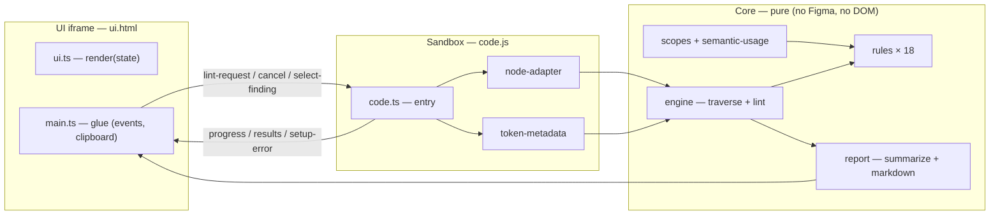

# Infomaniak's Design System - Figma Design Linter

A Figma plugin that lints a selection for design-token compliance. A designer selects
one or more layers, runs the plugin, and gets a list of errors and warnings: raw
(unbound) values, variables used outside their intended scope, semantic tokens used on
the wrong property, primitive tokens used where semantic tokens are expected, tokens
bound from unrecognized or local collections, bindings that cannot be resolved, raw
effects and stroke weights, hand-set opacity over colored layers, non-default blend
modes, brand/dataviz tokens missing their `@root` variant, leftover lorem ipsum copy,
and typography not driven by published text styles.

The plugin reads the document and lints it; it never modifies it.

## What it checks

| Rule               | Severity | Meaning                                                                                             |
| ------------------ | -------- | --------------------------------------------------------------------------------------------------- |
| Unbound value      | Error    | Property set with a raw value (`#4A90D9`, `16px`, `1` stroke weight…) and no design token bound     |
| Wrong scope        | Error    | A variable IS bound, but its Figma scopes don't cover the property (e.g. a stroke token on a fill)  |
| Wrong token        | Error    | A semantic (t2) color variable IS bound, but its category doesn't match the property                |
| Unbound effect     | Error    | An effect (shadow, blur…) is set with raw settings — no effect style or variable bound              |
| No text style      | Error    | A TEXT node carries no text style — typography set by hand                                          |
| Icon as frame      | Error    | A drawn container (frame/section/group) is named exactly like a kit icon — instance the icon        |
| Primitive misuse   | Warning  | The bound token effectively resolves to a primitive (t1) token — directly or through an alias chain |
| Unknown collection | Warning  | A variable IS bound, but points at no known token tier (t1/t2/t3)                                   |
| Unresolved token   | Warning  | A variable IS bound, but it can't be resolved from this file's variables or an accessible library   |
| Opacity over color | Warning  | The layer's opacity is hand-set below 100% while it carries a colored fill                          |
| Local effect style | Warning  | The effect comes from a style local to the file, not published from the token library               |
| Local text style   | Warning  | The text style is local to the file, not published from the token library                           |
| Style override     | Warning  | The node overrides a published text style (size, weight, decoration or line height)                 |
| Blend mode         | Warning  | The node's blend mode differs from the accepted `NORMAL`/`PASS_THROUGH`                             |
| Brand/dataviz root | Warning  | A bound t2 brand/dataviz token is not the `@root` variant (only those are published)                |
| Local collection   | Warning  | The bound variable comes from a collection local to the file — unpublished                          |
| Lorem ipsum        | Warning  | The text layer still carries placeholder copy (`lorem`/`ipsum`, any casing)                         |
| Local duplicate    | Warning  | A local component (or set) is named exactly like a kit icon — a duplicated icon in the file         |

**Alias chains**: a variable's value may be an alias to another variable. This is what
lets third-party tokens (e.g. a Shadcn kit's `foreground`) be re-pointed to DS tokens
in Figma: when the alias chain resolves to a t2/t3 token, the binding is **accepted**
— no warning fires. Chains landing on a t1 token are still flagged as primitive
misuse, and chains that dead-end (raw value, deleted target, cycle) keep the
unknown-collection warning. Wrong-token is deliberately not validated through the
chain (the alias only affects tier classification).

**Icon library exemption**: the Edelweiss Iconography library (`esds/icon/…`
components) publishes its own token collection (`Collection 1`), which is not a
t1/t2/t3 tier. Bindings inside instances of `esds/icon/…` components are therefore
exempt from the unknown-collection rule — the icon library's stroke-width tokens are
expected there. The identity is resolved per instance through
`getMainComponentAsync()` (component-set name, then component name, then the
instance's layer name — the sync getter is off-limits in dynamic-page mode):
renaming an icon instance keeps it exempt, but extracting its glyph out of it
re-flags the binding.

**Icon component checks**: every node also carries its raw Figma type, letting two
rules police icon usage by name — `icon-as-frame` (error) for drawn containers named
exactly like a kit icon, `local-duplicate` (warning) for local components duplicating
one. The name match is exact against the icon inventory generated from the svg-assets
package (`assets/svg/monotone/figma/*.svg`): renamed or partial names (`plus copy`,
`icon plus`) pass silently — the heuristic is deliberately conservative to avoid
name-based false positives. Detached icon instances surface as `icon-as-frame`
errors (detaching produces a frame keeping the icon name).

The "wrong token" rule derives the category of a bound variable from its own name
(`color/background/…`, `color/content/…`) — read live from the file, so it can't drift
from the token set:

| `color.*` category | Frame fill | Shape / icon fill | Text fill | Stroke |
| ------------------ | ---------- | ----------------- | --------- | ------ |
| `background`       | ✓          | ✓                 | ✗         | ✗      |
| `content`          | ✗          | ✓                 | ✓         | ✗      |
| `border`           | ✗          | ✗                 | ✗         | ✓      |
| `shadow`           | ✗          | ✗                 | ✗         | ✗      |

- Checked properties: colors (fills & strokes, incl. text color), auto-layout padding
  & gap, corner radius, stroke weight (only on nodes that actually carry a visible
  stroke — Figma defaults the weight to 1 everywhere), opacity (semi-transparent
  only), blend modes (non-default only), effects (per-effect, incl. effect-style
  bindings), text styles (applied style + size/weight/decoration/line-height
  overrides) and text content (placeholder copy). Uniform multi-part values (same
  value and binding on all padding sides / corners) are merged into a single finding
- Silently skipped: gradients, image/video fills, hidden layers (and their subtrees),
  hidden paint/effect layers, mixed values, zero-valued padding/gap/radius/stroke
  weight, default opacity (100%) and opacity 0 (reads as intentional hiding), default
  blend modes, and anything the rules can't classify
- Component instances **are** linted: overrides applied on an instance are the
  designer's responsibility, and bindings inherited from the source component are
  reported too. Token-bound findings display the token's collection
  (`color/content/primary · t2`) so unrecognized collections are immediately visible

## Using the plugin in Figma

> [!NOTE]
> The plugin reads the design tokens **live from the file's variables** — variables
> local to the file, or bound from a published library, resolved on demand through the
> Figma Variables API. A file without any token variables still lints raw values via
> the unbound-value rule.

### Build and install (development)

```shell
yarn build:figma-plugin-linter
```

Then, in the Figma desktop app:

1. Go to **Plugins → Development → Import plugin from manifest…**
2. Select `packages/figma/figma-plugin-linter/manifest.json`

> [!NOTE]
> The manifest `id` is a placeholder (`TODO_ID`) until the first desktop import assigns
> the real plugin id. Distribution to the org is done as a private plugin (see the
> spec's rollout plan).

### Run a lint

1. Pick a scope in the panel — **Selection** (default), **Page** or **File**
2. For the Selection scope, select one or more frames or layers on the canvas
3. Open the plugin and hit **Run lint**
4. Results appear as `N errors · M warnings`, errors first, **grouped by rule within
   each severity** — expand a rule section to see its findings and their messages
5. Click a finding to select the offending layer on canvas (and zoom to it)
6. Hit **Copy report** to get a markdown summary for handoff tickets (same rule
   grouping)
7. Fix the layers and hit **Run again** — results are a snapshot, there is no live watching

The Selection scope requires a non-empty selection (setup error otherwise). The Page
scope lints the current page's top-level layers and their subtrees; the File scope
lints every page. An empty page or file is a clean pass. Progress and cancel work the
same in every scope.

| State       | Reached when                   | Content                                                                            |
| ----------- | ------------------------------ | ---------------------------------------------------------------------------------- |
| Idle        | Plugin opened, nothing run yet | Title, scope picker, Run button, hint                                              |
| Setup error | No selection (Selection scope) | Blocking message with recovery hint + Retry                                        |
| Running     | Run clicked                    | `Checking layers…` shimmer, then `Checking 340/1200 layers…`, progress bar, Cancel |
| Results     | Run finished or cancelled      | Counts, findings grouped by rule (collapsible sections), Run again + Copy report   |
| Clean pass  | Run finished, zero findings    | "0 errors, 0 warnings — all checked properties are token-bound.", Run again        |

> [!NOTE]
> If the file's variables carry no scopes, the wrong-scope rule stays dormant — the
> wrong-token rule is unaffected.

## Architecture

Three layers with dependencies pointing inward: the Figma sandbox and the UI iframe
both reduce to thin adapters around a **pure core** that runs in plain Vitest without
the `figma` global.



- **`core/`** — pure functions and types: the data model (`LintNode` tree → property
  observations), the rules (pure functions over observations), the traversal +
  lint engine (progress, cancellation via cooperative yields), scope/semantic-usage
  helpers, and the report builders
- **`sandbox/`** — thin adapter over the Figma plugin runtime: converts the Figma
  selection into `LintNode`s, preloads token metadata once per run (local variables in
  bulk, then bound ids resolved on demand — collections → tiers, variable names →
  semantic categories, scopes), and posts messages to the UI
- **`ui/`** — the plugin panel: a pure state → DOM renderer plus a small bootstrap
  that wires clicks (run/cancel/copy/select) and sandbox messages

One run: `Run` → sandbox reads the selection → token metadata preloaded → node tree
adapted → engine traverses and evaluates the rules → findings summarized → posted to
the panel → click a row → sandbox selects and zooms to the node.

### Extending

- **Add a rule**: one file in `src/core/rules/` + one line in `registry.ts` — rules
  are pure functions over `PropertyObservation`s and never traverse the tree
- **Add a checked property**: extend the extraction in `sandbox/node-adapter.ts` +
  the required scopes in `core/scopes.ts`; existing rules pick it up via their
  `appliesTo` list

## Development

```shell
# build the plugin into dist/ (code.js, ui.html with inlined bundle)
yarn build:figma-plugin-linter

# run this package's tests (from the repo root)
yarn vitest run packages/figma/figma-plugin-linter
```

Tests are co-located with their modules (`*.test.ts`) and the package enforces the
repo's 100% coverage threshold (the entry-point glue — sandbox entry, iframe
bootstrap, build script — is excluded explicitly in the root `vitest.config.ts`).

Manual smoke checklist after a build:

- Frame with a planted raw fill → error
- Content token on a background → error
- Background token on text → error
- Primitive radius → warning
- t1 token bound on an instance fill → primitive-misuse warning
- Token bound from an unrecognized collection (e.g. a third-party kit) → unknown-collection warning
- Third-party token aliased to a t2/t3 token → accepted
- Third-party token aliased to a t1 token → primitive-misuse warning
- Instance + hidden layers → hidden skipped, instance linted
- Token bound from a published library → classified correctly
- Token bound to a deleted variable → unresolved-token warning
- Check the file's variables carry scopes (see note above)
- ≥2 rules triggered × ≥2 findings each → results grouped by rule within severity, counts correct, Copy report mirrors the grouping
- Page scope lints the whole current page (progress counts climb); cancel mid-scan stops promptly
- Empty page → clean pass message
- File scope on the DS source file: cancel responds within ~1s, no UI freeze (perf gate)
- Shape with a raw 1px stroke → unbound-value error naming the stroke weight
- Frame at 50% opacity with a bound background color → opacity-over-color warning
- Drop shadow with default (raw) settings → unbound-effect error
- Local effect style applied to a layer → local-effect-style warning; remote style → clean
- Frame set to Multiply → blend-mode warning
- Non-`@root` brand t2 token bound to a fill → brand/dataviz warning; `@root` variant → clean
- Local variable bound to a fill → local-collection warning (also inside the DS source file)
- Text layer with lorem placeholder → lorem-ipsum warning
- `esds/icon/…` instance (glyph stroke weights bound to the iconography library's `Collection 1`) → no unknown-collection warning; the same binding outside an icon → warning
- Text layer styled by hand → no-text-style error
- Local text style applied → local-text-style warning; remote style → clean
- Remote Token Core style applied, then size changed → style-override warning naming `font size`
- Regression: text color still linted (a raw text fill → unbound-value error)
- Frame named `chevron-right` (or `esds/icon/chevron-right`) → icon-as-frame error; a real kit-icon instance of the same name → clean
- Duplicated icon component in the file → local-duplicate warning
- Renamed icon frame (`plus copy`) → no component finding (exact-match policy)
