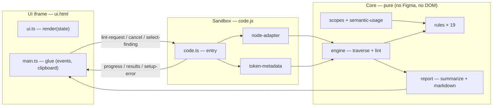

# Infomaniak's Design System - ESDS Linter

A Figma plugin that lints a selection for design-token compliance. A designer selects
one or more layers, runs the plugin, and gets a list of errors and warnings: raw
(unbound) values, variables used outside their intended scope, semantic tokens used on
the wrong property, primitive tokens used where semantic tokens are expected, tokens
bound from unrecognized or local collections, bindings that cannot be resolved, raw
effects and stroke weights, hand-set opacity over colored layers, non-default blend
modes, brand/dataviz tokens missing their `@root` variant, leftover lorem ipsum copy,
and typography not driven by published text styles. Designers choose which rules
apply through the panel's **Rules** view — the selection persists per user (see
«Rule selection»).

The plugin reads the document and lints it; the only writes happen when **you** click a
Fix button (see « Fix mode » below) — reporting itself never modifies the document.

## Fix mode

Findings whose raw value matches exactly one scope-covered token variable offer a
**Fix** button that binds the token (`#FF0000` → the token holding `#FF0000`); rule
sections with fixable findings offer a batch **Apply** button with a confirmation step.
The fix contract is deliberately narrow (exact matches only):

- **Colors** (fills, strokes): the observed hex must equal the variable's resolved
  value exactly; the match must be unique across scope-covered variables — two
  different tokens sharing the value → no suggestion
- **Floats** (padding, gap, corner radius, stroke weight): exact float equality, raw
  `0` never suggested; scope coverage required so Figma accepts the binding
- **Never suggested**: effects, opacity, text styles (no exact-match contract for
  them)

Suggestions are **tier-aware** so a fix never trades one warning for another:

- published library tokens are considered too (the plugin imports the enabled
  libraries' variables at lint time — cached by Figma per session), so consumer
  files get pointed at `color/background/brand/@root`, not at a local WIP primitive
- unknown-tier variables (local WIP collections) are never suggested
- colors are only suggested from t2/t3 tokens whose semantic category fits the
  property (a fix must never create a primitive-misuse or wrong-token finding);
  number fixes may use t1 primitives (spacing/radius usage is expected)
- when several tokens share the value, the Fix button opens a **choice list** —
  candidates ordered most-semantic first (t3 > t2 > t1, `@root` variants before
  their base), recommended candidate marked; a single candidate keeps the
  one-click Fix button

Applying a batch is one undo step (mutations run without interleaved async work); the
panel re-lints automatically after applying, and failed rows (layer gone, binding
rejected) stay visible with a `fix failed` marker.

## What it checks

| Rule               | Severity | Meaning                                                                                                                |
| ------------------ | -------- | ---------------------------------------------------------------------------------------------------------------------- |
| Unbound value      | Error    | Property set with a raw value (`#4A90D9`, `16px`, `1` stroke weight…) and no design token bound                        |
| Wrong scope        | Error    | A variable IS bound, but its Figma scopes don't cover the property (e.g. a stroke token on a fill)                     |
| Wrong token        | Error    | A semantic (t2) color variable IS bound, but its category doesn't match the property                                   |
| Unbound effect     | Error    | An effect (shadow, blur…) is set with raw settings — no effect style or variable bound                                 |
| No text style      | Error    | A TEXT node carries no text style — typography set by hand                                                             |
| Icon as frame      | Error    | A drawn container (frame/section/group) is named exactly like a kit icon — instance the icon                           |
| Primitive misuse   | Warning  | The bound token effectively resolves to a primitive (t1) token — directly or through an alias chain                    |
| Unknown collection | Warning  | A variable IS bound, but points at no known token tier (t1/t2/t3) — recognized Edelweiss kit collections are accepted  |
| Unresolved token   | Warning  | A variable IS bound, but it can't be resolved from this file's variables or an accessible library                      |
| Opacity over color | Warning  | The layer's opacity is hand-set below 100% while it carries a colored fill                                             |
| Local effect style | Warning  | The effect comes from a style local to the file, not published from the token library                                  |
| Local text style   | Warning  | The text style is local to the file, not published from the token library                                              |
| Style override     | Warning  | The node overrides a published text style (size, weight, decoration or line height)                                    |
| Blend mode         | Warning  | The node's blend mode differs from the accepted `NORMAL`/`PASS_THROUGH`                                                |
| Brand/dataviz root | Warning  | A bound t2 brand/dataviz token is not the `@root` variant (only those are published)                                   |
| Local collection   | Warning  | The bound variable comes from a collection local to the file — unpublished                                             |
| Lorem ipsum        | Warning  | The text layer still carries placeholder copy (`lorem`/`ipsum`, any casing)                                            |
| Local duplicate    | Warning  | A local component (or set) is named exactly like a kit icon — a duplicated icon in the file                            |
| Icon local import  | Warning  | A shape or instance that looks like a kit icon (name, size or asset heuristic) is not an instance of the published kit |

**Alias chains**: a variable's value may be an alias to another variable. This is what
lets third-party tokens (e.g. a Shadcn kit's `foreground`) be re-pointed to DS tokens
in Figma: when the alias chain resolves to a t2/t3 token, the binding is **accepted**
— no warning fires. Chains landing on a t1 token are still flagged as primitive
misuse, and chains that dead-end (raw value, deleted target, cycle) keep the
unknown-collection warning. Wrong-token is deliberately not validated through the
chain (the alias only affects tier classification).

**Known kit collections**: the platform kits (Edelweiss Material Kit, Shadcn kit,
iOS-iPadOS kit) bind tokens from Edelweiss - Token Core, which publishes semantic
collections beyond the tiers (`theme`, `dataviz`, `product`, `button-type`,
`button-size`, `badge-type`, `avatar-size`), and the Material Kit adds the
`Schemes/…` design-token namespace. Bindings from Edelweiss kit libraries are
therefore accepted by matching the **library** (`Edelweiss - …` prefix, stamped
during the library-import pass — see `core/known-kits.ts`): a new collection
inside a known kit needs no plugin change. Two guards: remote only (a collection
pasted into the file keeps its warning) and raw palette collections excluded
(`Red/100` still warns — the kit counterpart of primitive-misuse). Kit tokens
keep their `unknown` tier, so they are never suggested as fixes, and the other
rules — wrong-token, primitive-misuse — keep evaluating them normally.

**Icon library exemption**: the Edelweiss Iconography library (`esds/icon/…`
components) publishes its own token collection (`Collection 1`), which is not a
t1/t2/t3 tier. Bindings inside instances of `esds/icon/…` components are therefore
exempt from the unknown-collection rule — the icon library's stroke-width tokens are
expected there. The identity is resolved per instance through
`getMainComponentAsync()` (the sync getter is off-limits in dynamic-page mode) and
must check out on **both** signals: the component's name follows the `esds/icon/…`
convention **and** the main component is remote (`ComponentNode.remote` — published
from the team library). The layer name alone is never trusted: an in-file component
reusing the convention is a duplicate, its instances keep no exemption, and its
unpublished bindings surface. Renaming a genuine icon instance keeps it exempt, but
extracting its glyph out of it re-flags the binding.

**Icon component checks**: every node also carries its raw Figma type, letting three
rules police icon usage — `icon-as-frame` (error) for drawn containers named exactly
like a kit icon, `local-duplicate` (warning) for local components duplicating one,
and `icon-local-import` (warning) for icon-carrying shapes or instances that are not
verified kit instances. `icon-local-import` combines three signals, so a local icon
is caught even when nobody named it: an exact inventory-name match (bare name or
`esds/icon/` prefix, insensitive to the trailing spaces some kit component-set names
carry), Figma's own asset heuristic (`isAsset` — small vector graphic), and the
canonical kit icon sizes (16/20/24/32/40) on the node's bounds. Nodes whose subtree
carries an image fill stay silent (the asset heuristic fires for raster images too —
photos and avatars are not icons). Renamed or partial names (`plus copy`,
`icon plus`) without an icon shape pass silently — the heuristics are deliberately
conservative to limit false positives, at the accepted cost of flagging small logo
glyphs. Detached icon instances surface as `icon-as-frame` errors (detaching
produces a frame keeping the icon name).

> [!NOTE]
> The icon rules assume the linter runs on consumer files. Inside the Edelweiss
> Iconography kit file itself, every icon component is local (remote is only true
> once the kit is published and instanced elsewhere) — the same policy as the
> other local-* rules: library source files are not lint targets.

The "wrong token" rule derives the category of a bound variable from its own name
(`color/background/…`, `color/content/…`) — read live from the file, so it can't drift
from the token set:

| `color.*` category | Frame fill | Shape / icon fill | Text fill | Stroke |
| ------------------ | ---------- | ----------------- | --------- | ------ |
| `background`       | ✓          | ✓                 | ✗         | ✗      |
| `content`          | ✗          | ✓                 | ✓         | ✗      |
| `border`           | ✗          | ✗                 | ✗         | ✓      |
| `shadow`           | ✗          | ✗                 | ✗         | ✗      |

- Checked properties: colors (fills & strokes, incl. text color), auto-layout padding
  & gap, corner radius, stroke weight (only on nodes that actually carry a visible
  stroke — Figma defaults the weight to 1 everywhere), opacity (semi-transparent
  only), blend modes (non-default only), effects (per-effect, incl. effect-style
  bindings), text styles (applied style + size/weight/decoration/line-height
  overrides) and text content (placeholder copy). Uniform multi-part values (same
  value and binding on all padding sides / corners) are merged into a single finding
- Silently skipped: gradients, image/video fills, hidden layers (and their subtrees),
  hidden paint/effect layers, mixed values, zero-valued padding/gap/radius/stroke
  weight, default opacity (100%) and opacity 0 (reads as intentional hiding), default
  blend modes, and anything the rules can't classify
- Component instances **are** linted: overrides applied on an instance are the
  designer's responsibility, and bindings inherited from the source component are
  reported too. Token-bound findings display the token's collection
  (`color/content/primary · t2`) so unrecognized collections are immediately visible

## Using the plugin in Figma

> [!NOTE]
> The plugin reads the design tokens **live from the file's variables** — variables
> local to the file, or bound from a published library, resolved on demand through the
> Figma Variables API. A file without any token variables still lints raw values via
> the unbound-value rule.

### Build and install (development)

```shell
yarn build:figma-plugin-linter
```

Then, in the Figma desktop app:

1. Go to **Plugins → Development → Import plugin from manifest…**
2. Select `packages/figma/figma-plugin-linter/manifest.json`

> [!NOTE]
> The manifest `id` is a placeholder (`TODO_ID`) until the first desktop import assigns
> the real plugin id. Distribution to the org is done as a private plugin (see the
> spec's rollout plan).

### Run a lint

1. Pick a scope in the panel — **Selection** (default), **Page** or **File**
2. Optionally open **Rules** to choose which rules apply (see «Rule selection»)
3. For the Selection scope, select one or more frames or layers on the canvas
4. Open the plugin and hit **Run lint**
5. Results appear as `N errors · M warnings`, errors first, **grouped by rule within
   each severity** — expand a rule section to see its findings and their messages
6. Click a finding to select the offending layer on canvas (and zoom to it)
7. Hit **Copy report** to get a markdown summary for handoff tickets (same rule
   grouping)
8. Fix the layers and hit **Run again** — results are a snapshot, there is no live watching

The Selection scope requires a non-empty selection (setup error otherwise). The Page
scope lints the current page's top-level layers and their subtrees; the File scope
lints every page. An empty page or file is a clean pass. Progress and cancel work the
same in every scope.

| State       | Reached when                   | Content                                                                            |
| ----------- | ------------------------------ | ---------------------------------------------------------------------------------- |
| Idle        | Plugin opened, nothing run yet | Title, scope picker, Rules count, Run button, hint                                 |
| Setup error | No selection (Selection scope) | Blocking message with recovery hint + Retry                                        |
| Running     | Run clicked                    | `Checking layers…` shimmer, then `Checking 340/1200 layers…`, progress bar, Cancel |
| Results     | Run finished or cancelled      | Counts, findings grouped by rule (collapsible sections), Run again + Copy report   |
| Clean pass  | Run finished, zero findings    | "0 errors, 0 warnings — all checked properties are token-bound.", Run again        |
| Rules       | Rules button clicked           | Back button, one checkbox row per rule (title, severity, description), Reset       |

### Rule selection

The **Rules · N/19** button beside the scope picker opens a view listing every rule
with its severity and a one-line description. Toggling a rule applies from the next
run (including the automatic re-lint after a fix) and is persisted per user via
`figma.clientStorage` — the selection survives closing Figma and is stored per user
and per plugin, never in the file. **Reset to defaults** re-enables every rule.

- With every rule disabled, the Run button is disabled; the sandbox also refuses a
  run without rules with a «No rules enabled» setup error
- Unknown rule ids in a stored selection are ignored, so a selection survives plugin
  updates that add or remove rules; a missing or invalid stored value falls back to
  every rule enabled
- The selection is stored with the registry snapshot at save time (`ruleSelection.v2`):
  rules added **after** the last save default to enabled on the next load, so a plugin
  update never silently disables a new rule — rules the user explicitly muted stay
  muted (selections saved before versioning keep their stored ids as-is)
- The count label (`Rules · 14/19`) is always visible on the panel so a muted rule
  never comes as a surprise
- A clean pass with a subset of rules qualifies the message («the 3/19 enabled rules
  all passed») so a muted run never reads as a full compliance pass

> [!NOTE]
> If the file's variables carry no scopes, the wrong-scope rule stays dormant — the
> wrong-token rule is unaffected.

## Architecture

Three layers with dependencies pointing inward: the Figma sandbox and the UI iframe
both reduce to thin adapters around a **pure core** that runs in plain Vitest without
the `figma` global.



- **`core/`** — pure functions and types: the data model (`LintNode` tree → property
  observations), the rules (pure functions over observations), the traversal +
  lint engine (progress, cancellation via cooperative yields), scope/semantic-usage
  helpers, and the report builders
- **`sandbox/`** — thin adapter over the Figma plugin runtime: converts the Figma
  selection into `LintNode`s, preloads token metadata once per run (local variables in
  bulk, then bound ids resolved on demand — collections → tiers, variable names →
  semantic categories, scopes), and posts messages to the UI
- **`ui/`** — the plugin panel: a pure state → DOM renderer plus a small bootstrap
  that wires clicks (run/cancel/copy/select) and sandbox messages

One run: `Run` → sandbox resolves the enabled rules and reads the scan roots → token
metadata preloaded → node tree adapted → engine traverses and evaluates the rules →
findings summarized → posted to the panel → click a row → sandbox selects and zooms
to the node.

### Extending

- **Add a rule**: one file in `src/core/rules/` + one line in `registry.ts` — rules
  are pure functions over `PropertyObservation`s and never traverse the tree
- **Add a checked property** (e.g. effects in v2): extend the extraction in
  `sandbox/node-adapter.ts` + the required scopes in `core/scopes.ts`; existing rules
  pick it up via their `appliesTo` list

## Development

```shell
# build the plugin into dist/ (code.js, ui.html with inlined bundle)
yarn build:figma-plugin-linter

# run this package's tests (from the repo root)
yarn vitest run packages/figma/figma-plugin-linter
```

Tests are co-located with their modules (`*.test.ts`) and the package enforces the
repo's 100% coverage threshold (the entry-point glue — sandbox entry, iframe
bootstrap, build script — is excluded explicitly in the root `vitest.config.ts`).

Manual smoke checklist after a build:

- Frame with a planted raw fill → error
- Content token on a background → error
- Background token on text → error
- Primitive radius → warning
- t1 token bound on an instance fill → primitive-misuse warning
- Token bound from an unrecognized collection (e.g. a third-party kit) → unknown-collection warning
- Third-party token aliased to a t2/t3 token → accepted
- Third-party token aliased to a t1 token → primitive-misuse warning
- Token Core `theme`/`dataviz`/`product`/`button-*` binding (remote) → clean; `Schemes/…` Material role → clean
- Same kit collection pasted locally into the file → unknown-collection warning
- Instance + hidden layers → hidden skipped, instance linted
- Token bound from a published library → classified correctly
- Token bound to a deleted variable → unresolved-token warning
- Check the file's variables carry scopes (see note above)
- ≥2 rules triggered × ≥2 findings each → results grouped by rule within severity, counts correct, Copy report mirrors the grouping
- Page scope lints the whole current page (progress counts climb); cancel mid-scan stops promptly
- Empty page → clean pass message
- File scope on the DS source file: cancel responds within ~1s, no UI freeze (perf gate)
- Shape with a raw 1px stroke → unbound-value error naming the stroke weight
- Frame at 50% opacity with a bound background color → opacity-over-color warning
- Drop shadow with default (raw) settings → unbound-effect error
- Local effect style applied to a layer → local-effect-style warning; remote style → clean
- Frame set to Multiply → blend-mode warning
- Non-`@root` brand t2 token bound to a fill → brand/dataviz warning; `@root` variant → clean
- Local variable bound to a fill → local-collection warning (also inside the DS source file)
- Text layer with lorem placeholder → lorem-ipsum warning
- `esds/icon/…` instance (glyph stroke weights bound to the iconography library's `Collection 1`) → no unknown-collection warning; the same binding outside an icon → warning
- Instance of a local component named `esds/icon/plus` (duplicated icon) → icon-local-import warning, and its `Collection 1` bindings → unknown-collection warning
- Vector named `chevron-right` (local SVG import on the canvas) → icon-local-import warning; the same vector inside a real kit instance → clean
- Genuine kit-icon instance → clean for icon-local-import and unknown-collection; renamed kit instance (`plus` on canvas) → still exempt (identity resolved from the component, not the layer name)
- Instance of the kit set named `esds/icon/minus ` (trailing space) → no icon finding (inventory matching trims)
- Vector named `Vector path` (unnamed local SVG import, Figma marks it as asset) → icon-local-import warning
- Instance of a local component named `Icon` at 24×24 (Figma: «From this file») → icon-local-import warning; the same instance carrying an image fill (avatar) → clean
- Placed photo (rectangle with image fill) → no icon finding
- Text layer styled by hand → no-text-style error
- Local text style applied → local-text-style warning; remote style → clean
- Remote Token Core style applied, then size changed → style-override warning naming `font size`
- Regression: text color still linted (a raw text fill → unbound-value error)
- Frame named `chevron-right` (or `esds/icon/chevron-right`) → icon-as-frame error; a real kit-icon instance of the same name → clean
- Duplicated icon component in the file → local-duplicate warning
- Renamed icon frame (`plus copy`) → no component finding (exact-match policy)
- Raw `#FF0000` fill matching exactly one token → Fix button; apply → fill bound, auto re-lint clears the finding, one undo reverts
- 3 raw paddings matching tokens → batch Apply button, confirm → all applied, single undo reverts the batch; a failing row shows `fix failed`
- Findings for effects/opacity/text styles → no Fix button
- Rules view: toggle a rule off and run → no findings from that rule; count label reflects the selection
- Reopen the plugin → the rule selection is restored from clientStorage
- Reset to defaults → every rule re-enabled and persisted
- Disable every rule → Run button disabled; a run forced through the console reports «No rules enabled»
- Clean pass with a subset of rules → the success message names the enabled count (e.g. «the 3/19 enabled rules all passed»)
- Toggle rules → the next Run and the post-fix re-lint both apply the same selection
- Kit token aliased to a published DS t2/t3 token → accepted (alias chains re-verified with the values plumbing fix)
